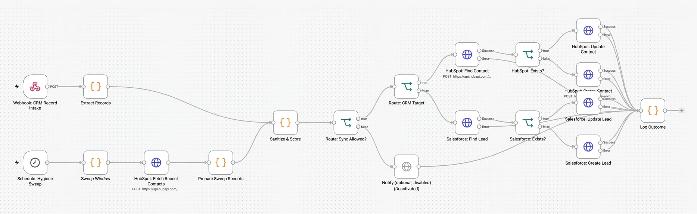
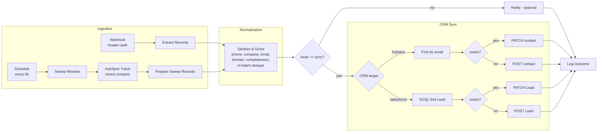

# CRM Data Hygiene Sentinel
> An event-driven **and** scheduled data hygiene workflow for [n8n](https://n8n.io) that cleans CRM records in real time, then syncs them to **HubSpot** or **Salesforce**.

<br>



<br>

[](LICENSE)


## What it does

| Capability | Behaviour |
|---|---|
| **Phone normalization** | Converts messy input to E.164 (`(415) 555-0132` → `+14155550132`), captures extensions separately, flags invalid numbers |
| **Company name formatting** | `acme widgets llc` → `Acme Widgets LLC`, `ACME  WIDGETS, INC` → `Acme Widgets Inc.`; preserves intentional mixed case (`McDonald's`, `eBay`) |
| **Personal-domain stripping** | `gmail.com`, `yahoo.com`, `outlook.com`, etc. are never used as a company domain. The email stays on the contact; only the account/domain association is withheld, and the record is flagged `PERSONAL_EMAIL` |
| **Corporate domain derivation** | Uses the website field first, then the email domain, and only if it is not a personal domain |
| **Duplicate detection** | Hard match on normalized email (within the batch and against the CRM); soft match on name + domain (flag only) |
| **Completeness scoring** | Configurable required fields, a 0–100 score, `MISSING_*` flags and a status of `complete`, `incomplete` or `unidentifiable` |
| **Safe by default** | Ships in **dry-run** mode. Nothing is written to your CRM until you opt in |

## Architecture



### 1. Ingestion
* **Event-driven:** `POST /webhook/crm-hygiene-sentinel` accepts a single record, an array, or `{ "records": [...] }`. Requests must carry your shared secret header, enforced by an n8n Header Auth credential. The webhook acknowledges immediately and processes asynchronously.
* **Scheduled sweep:** a Schedule Trigger (default every 6 hours) pulls HubSpot contacts created inside a lookback window (default 24h, max 100 per run) and runs them through the same pipeline.

### 2. Normalization (`Sanitize & Score` node)
Field names are matched case-insensitively and ignore underscores and spaces (`first_name`, `firstName` and `First Name` all work). Each record gets:
* cleaned `firstname`, `lastname`, `email`, `phone` (E.164), `company`
* `company_domain` with a `domain_source` of `website`, `email` or `none`
* `flags`, `missing`, `completeness`, `status`, and a `changes` audit trail (before → after)

### 3. Duplicate detection
| Level | Key | Effect |
|---|---|---|
| Hard | normalized email | The 2nd+ occurrence in a batch is routed to `duplicate` and **not synced** (first record wins) |
| Soft | name + corporate domain (or company) | Flag `POSSIBLE_DUPLICATE` only; the record still syncs |
| CRM | email lookup in HubSpot/Salesforce | Existing record → **update**; otherwise → **create** |

Phone numbers are deliberately **not** used as a match key, because colleagues often share a main line.

### 4. CRM sync
* **Non-destructive:** only non-empty sanitized values are written. Existing CRM data is never blanked.
* **HubSpot:** search → `PATCH` or `POST` on `/crm/v3/objects/contacts`.
* **Salesforce:** SOQL lookup on `Lead` by email (unconverted) → `PATCH` or `POST` on `/sobjects/Lead`. New Leads without a last name or company get Salesforce's conventional placeholders `[Unknown]` and `[Not Provided]`.
* Retries (3×) on every CRM call, with error outputs routed to the log instead of aborting the batch.

### Outcomes (emitted by `Log Outcome`)
`created` · `updated` · `dry_run` · `quarantine` (no valid email) · `duplicate` · `crm_error`

## Repository layout
```
crm-data-hygiene-sentinel/
├── README.md
├── LICENSE
├── .env.example
├── src/data-sanitizer.js            # standalone, dependency-free library + CLI
├── tests/sample-payload.json        # messy sample records
└── workflow/crm-hygiene-sentinel.json
```

## Setup (self-hosted n8n)

### Prerequisites
* A self-hosted n8n instance (Docker, npm, or Kubernetes) reachable over **HTTPS** if you want external webhooks
* Node.js 18+ (only for running the CLI test locally)
* A HubSpot Private App token **or** a Salesforce Connected App

### 1. Configure environment
```bash
cp .env.example .env
# edit .env, then start n8n with it
```

Minimal `docker-compose.yml`:
```yaml
services:
  n8n:
    image: docker.n8n.io/n8nio/n8n:latest   # pin an exact version in production
    restart: unless-stopped
    ports: ["5678:5678"]
    env_file: .env
    volumes: ["n8n_data:/home/node/.n8n"]
volumes:
  n8n_data:
```

> **Important:** the workflow reads its settings with `$env.*` inside Code nodes, which requires `N8N_BLOCK_ENV_ACCESS_IN_NODE=false`. This is a trade-off: it lets any workflow author on the instance read environment variables, so only enable it on instances you control. If env access is blocked (or your task-runner setup doesn't pass the variables through), the workflow falls back to safe defaults: HubSpot, dry-run on, country US. You can also edit the defaults directly in the `Sanitize & Score` node.

### 2. Create credentials in n8n
Secrets live in n8n's encrypted credential store, **not** in environment variables.

| Credential | Type | Used by |
|---|---|---|
| `Sentinel Webhook Secret` | Header Auth. Name: `X-Sentinel-Secret`, Value: your long random secret | Webhook trigger |
| `HubSpot Private App Token` | Header Auth. Name: `Authorization`, Value: `Bearer <token>` | HubSpot HTTP nodes |
| `Salesforce OAuth2` | Salesforce OAuth2 API | Salesforce HTTP nodes |

HubSpot Private App scopes: `crm.objects.contacts.read`, `crm.objects.contacts.write`.
Salesforce Connected App scopes: `api`, `refresh_token`.

### 3. Import the workflow
1. n8n → **Workflows → Import from file** → `workflow/crm-hygiene-sentinel.json`
2. Open each node showing a credential warning and select your credentials.
3. Save. Leave the workflow **inactive** for now.

### 4. (Optional) Create hygiene tracking properties
Only needed if you set `SENTINEL_WRITE_HYGIENE_PROPS=true`. Writing an unknown property makes the CRM reject the call.

| HubSpot (Contact) | Type | Salesforce (Lead) | Type |
|---|---|---|---|
| `sentinel_status` | Single-line text | `Sentinel_Status__c` | Text(30) |
| `sentinel_flags` | Multi-line text | `Sentinel_Flags__c` | Long Text Area |
| `sentinel_last_checked` | Date picker | `Sentinel_Last_Checked__c` | Date |

### 5. Test in dry-run
Click **Listen for test event** on the webhook node, then:
```bash
curl -X POST "https://YOUR-N8N-HOST/webhook-test/crm-hygiene-sentinel" \
  -H "X-Sentinel-Secret: $WEBHOOK_SECRET" \
  -H "Content-Type: application/json" \
  -d @tests/sample-payload.json
```

Inspect the `Sanitize & Score` and `Log Outcome` node output. You can also run the library locally with no n8n at all:
```bash
node src/data-sanitizer.js tests/sample-payload.json
```

**Expected results for `tests/sample-payload.json`**
| # | Scenario | Expected |
|---|---|---|
| 1 | Lowercase company, gmail, `(415) 555-0132` | `+14155550132`, `Acme Widgets LLC`, `PERSONAL_EMAIL`, complete |
| 2 | Corporate email, `ext 22`, `ACME  WIDGETS, INC` | `+14155550199`, ext `22`, `Acme Widgets Inc.`, domain `acme-widgets.com` |
| 3 | Same email as #1, different casing | route `duplicate` |
| 4 | Email + company only | `incomplete`: `MISSING_FIRSTNAME`, `MISSING_LASTNAME`, `MISSING_PHONE`; `Globex Corp.` |
| 5 | UK number with `country: GB` | `+442079460958`, `Hooli Ltd.` |
| 6 | Bangladesh number with `country: BD` | `+8801712345678`, `Dhaka Traders & Co.` |
| 7 | No email | `unidentifiable` → `quarantine` |
| 8 | Invalid email + junk phone + `N/A` company | `INVALID_EMAIL`, `INVALID_PHONE`, `quarantine` |
| 9 | Yahoo email + website URL | `PERSONAL_EMAIL`, domain `initech.com` from website, `O'Neil` |

### 6. Go live
1. Set `SENTINEL_DRY_RUN=false` in `.env` and restart n8n.
2. Set `SENTINEL_CRM_TARGET` to `hubspot` or `salesforce`.
3. **Activate** the workflow and switch your sender to the production URL `/webhook/crm-hygiene-sentinel`.

## Configuration reference

| Variable | Default | Description |
|---|---|---|
| `SENTINEL_CRM_TARGET` | `hubspot` | `hubspot` or `salesforce` |
| `SENTINEL_DRY_RUN` | `true` | When `true`, nothing is written to the CRM |
| `SENTINEL_DEFAULT_COUNTRY` | `US` | ISO-2 country used for numbers without a country code. A record's own `country` field wins if recognised |
| `SENTINEL_REQUIRED_FIELDS` | `email,firstname,lastname,company,phone` | Fields counted for completeness |
| `SENTINEL_EXTRA_PERSONAL_DOMAINS` | *(empty)* | Comma-separated extra domains to treat as personal |
| `SENTINEL_WRITE_HYGIENE_PROPS` | `false` | Write status/flags/date to custom CRM fields |
| `SENTINEL_SWEEP_LOOKBACK_HOURS` | `24` | Window for the scheduled HubSpot sweep |
| `SENTINEL_ALERT_WEBHOOK_URL` | *(empty)* | Slack-compatible incoming webhook for the optional (disabled) notify node |
| `SALESFORCE_INSTANCE_URL` | *(empty)* | e.g. `https://yourorg.my.salesforce.com`. Required when targeting Salesforce |
| `SALESFORCE_API_VERSION` | `v62.0` | REST API version |

## Known limitations
* **Phone parsing is heuristic.** It handles common NANP and international formats but doesn't validate per-country numbering plans or handle forms like `+44 (0)20…`. For stricter validation, swap in [`libphonenumber-js`](https://www.npmjs.com/package/libphonenumber-js) (self-hosted n8n supports `NODE_FUNCTION_ALLOW_EXTERNAL`).
* **Sweep:** HubSpot only, newest 100 contacts created in the window per run, no pagination.
* **Salesforce:** matches `Lead` only (not `Contact`/`Account`).
* **HubSpot search is eventually consistent.** Two requests with the same email within a few seconds can both miss each other.
* **In-batch duplicates:** first record wins. Fields from later duplicates are not merged.
* **Personal-domain list is finite.** Extend it with `SENTINEL_EXTRA_PERSONAL_DOMAINS`.
* The Code node contains a copy of `src/data-sanitizer.js` logic. If you change one, change the other.

## Security notes
* Serve n8n over HTTPS and use a long random webhook secret. Rotate it periodically.
* Use least-privilege CRM scopes. Never commit `.env`.
* n8n stores execution data, which will contain PII from your payloads. Configure pruning (see `.env.example`) and restrict access to the n8n UI.

## Disclaimer
**THIS SOFTWARE IS PROVIDED "AS IS", WITHOUT WARRANTY OF ANY KIND**, express or implied, including but not limited to the warranties of merchantability, fitness for a particular purpose and noninfringement. In no event shall the authors or copyright holders be liable for any claim, damages or other liability, whether in an action of contract, tort or otherwise, arising from, out of or in connection with the software or the use or other dealings in the software. This includes, without limitation, data loss, data corruption, incorrect merges or overwrites in your CRM, and service charges.

**You are solely responsible for:**
* **Data privacy compliance.** This includes GDPR, UK GDPR, CCPA/CPRA and any other law that applies to you. That covers having a lawful basis for processing, data minimization, honoring access/deletion/opt-out requests, cross-border transfer rules, retention limits, and data processing agreements with your CRM and hosting providers. Payloads processed by this workflow contain personal data and may be persisted in n8n execution logs.
* **CRM API rate limits and terms of service.** HubSpot, Salesforce and any other API have their own quotas and usage terms, which change over time. Review them, tune batch sizes and schedules accordingly, and monitor usage. The bundled retry and batching settings are starting points, not guarantees.
* **Testing before production.** Run in dry-run mode, test against a sandbox or a copy of your data, and keep backups of your CRM.

Nothing in this repository is legal advice.

## Contributing
Issues and PRs are welcome. Please include a sample payload that reproduces any normalization bug.

## License
[MIT](LICENSE) © DH Robin Systems
